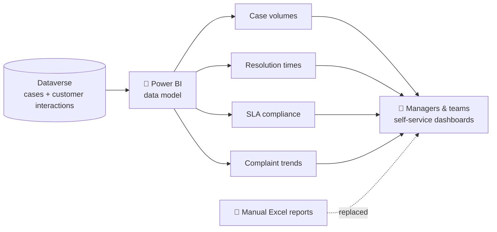

# 📊 Service Performance Reporting — Case Study

> Automated Power BI dashboards on case and customer interaction data, replacing manual Excel reporting.

---

## 🧩 Business problem

Service performance was reported **manually in Excel**. Pulling case and customer interaction data together by hand took time and gave no live view of case volumes, resolution times or SLA compliance.

## 💡 Solution overview

**Automated Power BI dashboards** built on **Dataverse** case and customer interaction data, covering:

- 📦 **Case volumes**
- ⏳ **Resolution times**
- ⏱️ **SLA compliance**
- 📈 **Complaint trends**

## 🏗️ Workflow / architecture

## ✨ Key features

- Automated dashboards connected directly to Dataverse
- KPIs for case volumes, resolution times and SLA compliance
- Complaint trend analysis
- Replaces manual Excel reporting

## 👩‍💼 My role

- Designed and built the Power BI dashboards on Dataverse data

## 📈 Outcomes

- ✅ Replaced manual Excel reporting
- ✅ Cut reporting time by an **estimated 30%**

## 🖼️ Screenshots

> _Screenshots coming soon._ Sample or anonymised data only.

| Overview | SLA compliance | Complaint trends |
|---|---|---|
| _placeholder_ | _placeholder_ | _placeholder_ |

## 🧠 Key learnings

- Connecting directly to Dataverse removes the copy-paste step that makes Excel reports slow and error-prone.
- A small set of clear KPIs (volume, resolution time, SLA compliance) answers most day-to-day service questions.

---

Built by [Mubeena M E](https://github.com/mubeename) · [LinkedIn](https://www.linkedin.com/in/mubeename)
